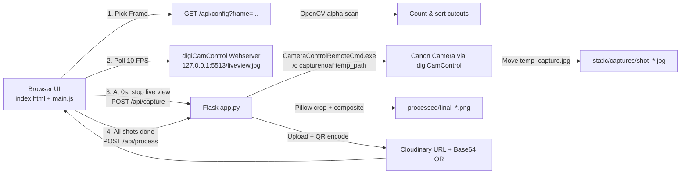

# DIY Photobooth Software

A full-screen, browser-based photobooth application built with **Flask**, **OpenCV**, **Pillow**, and **Cloudinary**. Guests pick a photo strip layout (`2-cut`, `3-cut`, or `4-cut`), pose in front of a mirrored Live View with a 10-second countdown, and scan an instant QR code to download their composited photo strip.

> [!IMPORTANT]
> **Camera & OS Compatibility Notice (Canon + Windows + digiCamControl)**
>
> This software was built and tested specifically for the author's **Canon camera** connected via USB to **Windows**, controlled through **digiCamControl** (`CameraControlRemoteCmd.exe` + local HTTP Live View server on port `5513`).
>
> **If you are using a different camera brand (Sony, Nikon, Fujifilm, etc.), an unsupported Canon model, macOS/Linux, or a webcam/capture card**, digiCamControl may not support Live View or remote shutter for your setup. You will need to adapt the camera backend to an alternative that fits your hardware combo — see [Adapting for Other Cameras & Setups](#adapting-for-other-cameras--setups).

---

## Features

- **Interactive Kiosk UI**: Clean, unscrollable full-screen interface (`Idle` -> `Layout Picker` -> `Instructions` -> `Capture Loop` -> `Processing` -> `Result & QR`).
- **Dynamic Layout Selection**: Supports `2-cut`, `3-cut`, and `4-cut` frames out of the box (`frame_2cut.png`, `frame_3cut.png`, `frame_4cut.png`).
- **Automatic Cutout Detection**: Uses OpenCV to scan transparent holes (`alpha == 0`) in any RGBA PNG frame, automatically determining the required shot count and cutout coordinates (sorted top-to-bottom, left-to-right).
- **Smart Photo Compositing**: Automatically center-crops each photo to match each frame hole's aspect ratio (zero stretching/distortion), resizes with LANCZOS resampling, and alpha-composites the frame over the photos.
- **Mirrored Live View & Flash**: Polls Live View at 10 FPS with CSS horizontal mirroring (`scaleX(-1)`) so guests see themselves like a real mirror, plus a screen flash animation at `0s`.
- **Instant Cloud Sharing & QR Code**: Uploads the final strip to **Cloudinary** and renders a scannable QR code on screen, while keeping local backups in `processed/`.

---

## How It Works (Architecture)



### Project Structure

```text
.
├── app.py                     # Flask backend: frame analysis, capture trigger, compositing, Cloudinary/QR
├── generate_frame.py          # Helper script showing how to programmatically generate a transparent 2x2 PNG frame
├── requirements.txt           # Python dependencies
├── .env.example               # Template for Cloudinary & digiCamControl environment variables
├── .gitignore                 # Excludes .env, __pycache__, test.jpg, and captured/processed photos
├── README.md                  # Full project & developer documentation
├── README.txt                 # Plain-text quick start guide
├── templates/
│   └── index.html             # Multi-state kiosk UI (Idle, Frame Selection, Instructions, Capture, Processing, Result)
├── static/
│   ├── css/
│   │   └── style.css          # Dark kiosk styling, mirrored live view, countdown shadow, flash animation
│   ├── js/
│   │   └── main.js            # State machine, Live View polling, 10s countdown loop, API calls
│   ├── assets/
│   │   ├── frame_2cut.png     # Active 2-photo frame template (RGBA PNG with transparent holes)
│   │   ├── frame_3cut.png     # Active 3-photo frame template
│   │   ├── frame_4cut.png     # Active 4-photo frame template
│   │   ├── dummy_frame_2cut.png
│   │   ├── dummy_frame_3cut.png
│   │   └── dummy_frame_4cut.png
│   └── captures/              # Temporary raw shots downloaded from camera (gitignored)
└── processed/                 # Final composited photo strips saved locally (gitignored)
```

---

## Prerequisites & Setup (Canon + Windows)

### 1. Software Prerequisites
1. **Python 3.10+** — Download from [python.org](https://www.python.org/) and check **"Add Python to PATH"** during installation.
2. **digiCamControl** — Download and install from [digicamcontrol.com](https://digicamcontrol.com/) (default install path: `C:\Program Files (x86)\digiCamControl\`).
3. **Cloudinary Account** — Sign up for a free account at [cloudinary.com](https://cloudinary.com/) and note your **Cloud Name**, **API Key**, and **API Secret** from the dashboard.

### 2. Install Project Dependencies
Clone this repository and install the required Python packages:

```bash
git clone <your-repo-url>
cd <repo-folder>
pip install -r requirements.txt
```

### 3. Configure Environment Variables (`.env`)
Copy `.env.example` to `.env` and fill in your Cloudinary credentials:

```powershell
copy .env.example .env
```

Edit `.env`:
```env
CLOUDINARY_CLOUD_NAME=your_cloud_name
CLOUDINARY_API_KEY=your_api_key
CLOUDINARY_API_SECRET=your_api_secret

DIGICAM_REMOTE_CMD=C:\Program Files (x86)\digiCamControl\CameraControlRemoteCmd.exe
DIGICAM_CAPTURE_CMD=capturenoaf

# Optional: Only set this if your Windows username contains spaces!
# TEMP_CAPTURE_PATH=D:\photobooth_temp\temp_capture.jpg
```

> [!WARNING]
> **Windows Username with Spaces:** `CameraControlRemoteCmd.exe` has a command-line parsing bug where file paths containing spaces (or double quotes) fail to save. By default, `app.py` saves temporarily to `C:\Users\<YourUsername>\temp_capture.jpg` and moves the file to `static/captures/`. If your Windows username contains a space (e.g., `John Doe`), uncomment `TEMP_CAPTURE_PATH` in `.env` and set it to a writable path with **no spaces** (e.g., `D:\photobooth_temp\temp_capture.jpg`). Do **not** use `C:\temp_capture.jpg` directly because Windows UAC blocks writes to `C:\` root.

### 4. Configure digiCamControl & Camera
1. Connect your Canon camera to your PC via USB and turn it **ON** (set camera auto-power-off to Disabled/Off, and set image quality to JPEG or smaller for fast USB transfer).
2. Open **digiCamControl** and wait for it to detect your camera.
3. Go to **File -> Settings -> Webserver**:
   - Check **"Use web server"**
   - Set **Webserver Port** to `5513`
   - Check **"Allow interaction via webserver"**
   - Click **OK**, then **restart digiCamControl** and leave it running in the background.
4. *(Tip)* For reliable shooting in party/low-light environments, consider setting your lens to **Manual Focus (MF)** or pre-focusing, since `capturenoaf` triggers the shutter immediately without waiting for autofocus hunting.

---

## Running the Photobooth

1. Ensure **digiCamControl** is open and connected to your camera.
2. Start the Flask server from the project folder:
   ```bash
   python app.py
   ```
3. Open **Google Chrome** (or Edge) and navigate to:
   ```text
   http://127.0.0.1:5000
   ```
4. Press **`F11`** to enter full-screen kiosk mode.
5. Guests tap **Start** -> select **2 Photos / 3 Photos / 4 Photos** -> tap **Start** on the instructions card -> pose for each 10-second countdown -> scan the QR code to download!

---

## Customizing Photo Frames

Frames live in `static/assets/`:
- `frame_2cut.png`
- `frame_3cut.png`
- `frame_4cut.png`

### Frame Requirements
1. Format must be **PNG with an Alpha channel (RGBA)**.
2. The photo windows must be **fully transparent** (`alpha == 0`). White or solid-colored boxes will **not** be detected as holes.
3. Each cutout area must be larger than `2000` square pixels (smaller transparent specks are ignored as noise).
4. Cutouts are automatically ordered **top-to-bottom, left-to-right** (grouped into rows within half the average cutout height).

You can also run `python generate_frame.py` as a minimal code example that generates a `1920x1080` 2x2 transparent frame (`static/assets/frame.png`). To add more frame choices to the UI, add new `<div class="frame-option" onclick="selectFrame('your_frame.png')">` cards in `templates/index.html`.

---

## Adapting for Other Cameras & Setups

Only **two** places in the entire codebase talk to the camera. Everything else (UI, countdown, frame cutout detection, cropping, compositing, Cloudinary upload, QR code) is 100% camera-agnostic:

1. **Live View Stream (`static/js/main.js`)**:
   - Look at `startLiveView()` / `stopLiveView()`, which polls `http://127.0.0.1:5513/liveview.jpg` every `100ms` (`10 FPS`) and pauses polling during capture to free USB bandwidth.
2. **Shutter Trigger & File Retrieval (`app.py`)**:
   - Look at `POST /api/capture`, which invokes `DIGICAM_REMOTE_CMD` (`CameraControlRemoteCmd.exe /c capturenoaf <temp_path>`) and polls up to 35 seconds for the JPG to appear.

### Alternative Combos to Explore
| Your Hardware / OS | Recommended Alternatives | What to Change in Code |
|---|---|---|
| **Nikon / Supported Sony via digiCamControl (Windows)** | Try digiCamControl first (check [supported cameras](https://digicamcontrol.com/cameras)). If `capturenoaf` isn't supported on your body, change `DIGICAM_CAPTURE_CMD=capture` in `.env`. | Usually `.env` only, or verify Live View URL in `main.js`. |
| **Sony Alpha / ZV Cameras** | **Sony Imaging Edge Desktop** (Webcam/Remote), **gPhoto2** (Linux/macOS), or **HDMI Capture Card**. | Replace `CameraControlRemoteCmd.exe` in `/api/capture` and Live View source in `main.js`. |
| **Fujifilm / Panasonic / Olympus** | Vendor tethering tools (e.g. Fujifilm X Acquire, LUMIX Tether), **gPhoto2** (Linux/macOS/WSL), or **HDMI Capture Card**. | Replace `/api/capture` with CLI/SDK capture or OpenCV frame grab. |
| **macOS or Linux with Any DSLR/Mirrorless** | **`gphoto2`** (`gphoto2 --capture-image-and-download --filename ...`) + MJPEG/OpenCV preview stream. | Swap `subprocess.run(...)` in `/api/capture` to `gphoto2` and expose an MJPEG Flask route for `live-view`. |
| **Webcam or Clean-HDMI Capture Card (Easiest Universal Option)** | **OpenCV (`cv2.VideoCapture`)** or browser **`navigator.mediaDevices.getUserMedia()`**. | Stream frames via Flask MJPEG or `<video>` element in `index.html`, and grab a frame directly on capture. |

---

## API Reference

| Method & Endpoint | Description | Request / Params | Response |
|---|---|---|---|
| `GET /` | Serves the photobooth kiosk web UI (`templates/index.html`). | — | HTML page |
| `GET /api/config` | Scans the selected PNG frame's alpha channel and returns the number of detected photo cutouts. | Query: `?frame=frame_2cut.png` | `{"shots_required": 2}` |
| `POST /api/capture` | Triggers camera capture via digiCamControl, waits up to 35s, and moves the shot to `static/captures/`. | — | `{"status": "success", "filename": "shot_...jpg"}` |
| `POST /api/process` | Crops & composites captured shots behind the selected frame, saves to `processed/`, uploads to Cloudinary, and returns a QR code. | JSON: `{"filenames": [...], "frame": "frame_2cut.png"}` | `{"status": "success", "image_url": "...", "qr_base64": "..."}` |

---

## Troubleshooting

- **Capture times out (`500` error) or `CameraControlRemoteCmd` logs `response:null`:**
  - Make sure the **digiCamControl GUI** is open and showing your camera connected (not blocked by Canon EOS Utility running at the same time — close Canon EOS Utility!).
  - Make sure `TEMP_CAPTURE_PATH` has **zero spaces** and is not `C:\` root.
  - Check that the camera is not stuck trying to autofocus in dark lighting (switch lens to MF or keep `DIGICAM_CAPTURE_CMD=capturenoaf`).
- **Live View is blank or frozen:**
  - Verify digiCamControl Webserver is enabled on port `5513` (`File -> Settings -> Webserver`) and digiCamControl was restarted after changing settings.
  - Open `http://127.0.0.1:5513/liveview.jpg` directly in Chrome to confirm digiCamControl is serving Live View frames.
- **`No valid cutouts detected in frame` (`shots_required: 0`):**
  - Ensure your `frame_*cut.png` file exists in `static/assets/`, is an RGBA PNG (4 channels), and has truly transparent holes (`alpha = 0`), not white-filled boxes.
- **Cloudinary upload fails at the end:**
  - Verify `.env` exists in the project root with valid `CLOUDINARY_CLOUD_NAME`, `CLOUDINARY_API_KEY`, and `CLOUDINARY_API_SECRET` values, and that your PC has internet access. (Note: the composited image is still saved locally inside `processed/`.)
